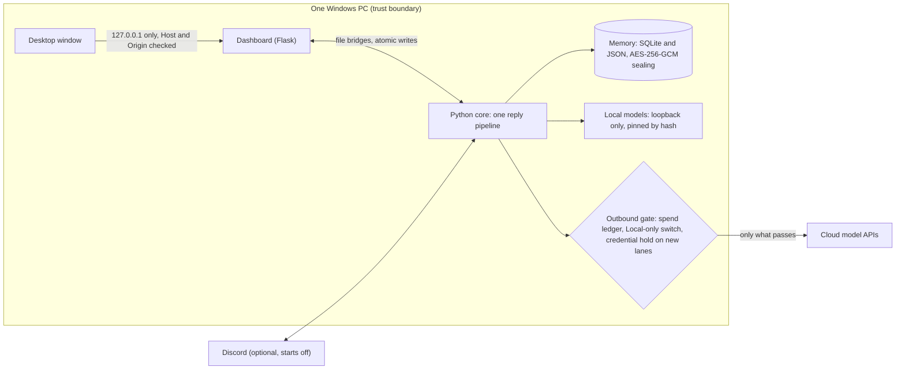

# Katt-AI

**A private, security-first AI companion and agent harness I build solo, working toward her
own small, fast local model.**

Katt-AI runs on one Windows PC. A Python core sits behind a localhost-only dashboard in a
native desktop window. Discord is optional and starts off. Chat, memory and decisions stay on
the machine unless I approve a send.

> **This repository is the public front page. The source code is private on purpose.**
> The working repository holds personal data paths, a private voice corpus and its full commit
> history. Git keeps everything ever committed, so I publish a fresh, reviewed summary
> instead of the repository itself. File names below refer to the private repository, and I
> am glad to walk through any of them live.

## About me

- **Kevin** ([K31C0](https://github.com/K31C0))
- WGU B.S. Cybersecurity (in progress). CompTIA A+, Network+, Security+.
- Open to IT support, SOC and junior security roles.

## At a glance

| | |
| --- | --- |
| **Team** | Solo owner-developer directing two AI coding agents |
| **History** | 430+ commits in the private repository since July 2026 |
| **Tests** | 90+ test suites; all of them run on every commit |
| **Stack** | Python 3, Flask, SQLite, a native desktop shell, local models on loopback, cloud model APIs behind a gate |
| **Rule that shapes everything** | The PC can lose power at any moment, so every feature must survive a kill mid-write |

## Architecture and trust boundaries

- **Nothing listens beyond loopback.** The dashboard and the local model server bind
  127.0.0.1.
- **Cloud calls are gated.** Every cloud call reserves budget in a spend ledger first, and a
  Local-only switch is checked again before each cloud attempt. The trial lane and the new
  cloud lanes also pass a credential detector that holds secrets before a send.
- **The model never acts alone.** File requests from the model wait for my approve or reject,
  bound to a content hash.

## What it proves

Each row is one interview story: the problem, what I built, the result.

| Skill | What I built | Where it lives | State |
| --- | --- | --- | --- |
| **Encryption at rest, key management** | Chat-derived files sealed with AES-256-GCM under keys from a DPAPI-wrapped keyring. Sealed mode has no plaintext fallback: a locked store refuses every model call and answers with a fixed "memory locked" line. A journaled migration tool keeps the originals and can roll back. | `src/sealed_store.py`, `src/content_store.py`, `scripts/manage_sealed_store.py`, `tests/test_sealed_store.py`, `tests/test_manage_sealed_store.py` | **Built and independently reviewed; rollout pending** |
| **Least privilege, small attack surface** | The dashboard binds 127.0.0.1 only. Every write request must carry a loopback Host and, when a browser sends one, the dashboard's own Origin. That blocks DNS rebinding and cross-site posts. The local-decision trial script refuses any socket outside loopback. | `src/dashboard.py`, `tests/test_dashboard_endpoints.py`, `scripts/decides_trial.py` | Live |
| **Secure change control** | A pre-commit guard blocks mass deletions, protected paths, deleted files and secrets in staged changes. The commit hook then runs every test suite on an isolated copy of what is staged, with a detector that fails the run if a test writes into real runtime data. | `scripts/guard.py`, `tests/test_guard.py`, `tests/run_all.py`, `tests/test_run_all.py` | Live on every commit |
| **Resilience and recovery** | Built for a host that can lose power at any moment: atomic writes, idempotent loops, a complete copy of a damaged file before anything replaces it, and simulated power cuts after every file operation in the migration tool. | `tests/test_memory_durability.py`, `tests/test_manage_sealed_store.py`, `src/schedule_core.py`, `tests/test_shutdown_bridge.py` | Live |
| **LLM application security** (OWASP Top 10 for LLM Applications) | **Prompt injection:** stored chat lines are neutralized so text cannot forge a speaker label. **Sensitive data disclosure:** a credential detector holds secrets before any send on the trial cloud lane, and the next reply lane is built on it (not yet switched on). **Excessive agency:** file requests from the model wait for my approve or reject, bound to a content hash. **Unbounded consumption:** every paid call reserves budget in a spend ledger first. | `src/katt_memory.py`, `src/data_lanes.py`, `src/katt_folder.py`, `src/model_harness.py`, `src/openrouter_adapter.py` and their test suites | Live |
| **Measured engineering** | I measure before I decide. A local-model bake-off picked the fast model on numbers (139 tokens a second, 1.26 s median reply, 12 of 12 checks). A speed bench found a 107M-parameter layout that holds 1,405 tokens a second on my GPU before any training money was spent. A 200-item routing test showed one-letter decisions are 2.4x faster than JSON (64 vs 152 ms) but 14 points less accurate (66.5% vs 80.5%), so the slower path stays for now. | `src/llama_server.py`, `scripts/model_lab_s0.py`, `scripts/model_lab_s4.py`, `tests/test_katt_decides.py` | Benches done; a 107M base model is pretrained; distillation and fine-tuning are next |

## How I build with AI

I direct two AI coding agents (Claude and Codex). I own the architecture, the security rules,
the reviews and the final call. The agents work under written rules: one builds, the other
reviews, and a guard enforces the rules at commit time. Tests gate every commit. Privacy
sends, spend, protected-state runs and any public release need my approval.

This is AI governance in practice: a policy, a control that enforces it, and evidence that the
control ran.

## Roadmap

| Shipped | Building | Research |
| --- | --- | --- |
| Desktop app with a localhost dashboard and one reply pipeline for app and Discord | Tools on the local route: read my schedule, set reminders | **Katt 0.1:** the project's own small model, about 107M parameters, target 1,000 tokens a second beside a game |
| Per-person memory that survives restarts | Local decisions before any cloud call (trial against a gold set) | Katt 0.2: taught by an openly licensed teacher model |
| Spend ledger with hard monthly caps | Encryption at rest rollout (built and reviewed) | Katt 0.3 and later: one measured experiment at a time |
| Crash consistency: state survives a kill or power loss at any moment | A verifier that accepts a model's claim only when it re-computes against evidence | A fixed personal benchmark that must not regress |
| Local model routes pinned by hash, loopback only | | |
| Reminders with Windows notifications | | |

Third-party models (Qwen, Gemini) serve as engines, teachers and evaluation baselines. The
project's own model is trained from scratch on public, license-carded data.

## What works (curated receipts)

Format: date, what works, the test or script that shows it.

- **2026-11-14 - Security lab, host side:** a broker refuses tools off an allowlist, malformed output, unsafe paths and any VM setup with a way back to the PC; nothing native runs yet. `tests/test_seclab.py`
- **2026-11-14 - A memory wipe is complete and crash-safe:** short conversation scenes are recalled only in their own room, and a wipe removes them too, even when power is lost mid-wipe. `tests/test_memory_durability.py`
- **2026-11-14 - No lost reply:** when a bigger local model refuses or cannot be reached, the reply steps down to the smaller local model, on the PC, inside a two-attempt limit. `tests/test_model_harness.py`
- **2026-11-12 - Model mode and per-model levels:** one control sets Auto, Manual or Local-only, Local-only is checked again before every cloud attempt, and each model has its own temperature, reply length, context and reasoning levels. `tests/test_model_harness.py`
- **2026-11-12 - Live checks on a test copy:** a second instance boots offline in an empty temp folder and answers synthetic messages through the real reply path at $0, without touching real chat or memory. `scripts/live_check.py`, `tests/test_live_check.py`
- **2026-11-12 - Local routing in shadow mode:** a rules engine returns typed routing choices beside today's cloud router and counts agreement without storing message text; the router stays unchanged until I flip it. `tests/test_katt_decides.py`
- **2026-11-12 - Hardware tiers:** the app measures RAM, VRAM and free disk, picks Lite, Low, Medium or High, and the tier caps the power setting without rewriting the saved one. `tests/test_mobility.py`
- **2026-11-12 - Katt 0.1 tokenizer and data:** a byte-level tokenizer (16k ids) and 2.42 billion tokens of public, license-carded training data with 0 overlap with the held-out sets. `tests/test_katt01_tok.py`, `tests/test_katt01_fetch.py`
- **2026-11-12 - Escalation by fixed rules:** an image, a long message or "think harder" moves a reply one step up the local model ladder, every reply shows which model answered, and nothing goes to a cloud model until I confirm in the chat.
- **2026-11-12 - Training data fence:** a standard-library check refuses any training row without a license, hash or source, and any teacher model off the allowlist. `tests/test_katt01_data.py`
- **2026-11-11 - Discord stand-in:** when someone mentions me and I stay silent, Katt answers as herself, never as me; a tripwire swaps any reply that speaks for me. `tests/test_discord_rules.py`
- **2026-11-11 - Cloud model trials inside a budget:** at most 2 cheap new models a day on fixed synthetic prompts, inside $3 a month; a served-host mismatch shuts the lane. `tests/test_cloud_trials.py`, `tests/test_openrouter_adapter.py`
- **2026-11-11 - Diagnosable pre-flight checks:** a refused local test run names the exact check that failed. `scripts/qualify_local.py`
- **2026-11-10 - Verifier core:** a default-deny gate accepts a candidate answer only when its quotes or arithmetic re-compute against supplied evidence. `tests/test_slop_filter.py`
- **2026-11-08 - Chat encryption (built, rollout pending):** AES-256-GCM envelope, journaled migration with rollback, simulated power cuts after every file operation. `tests/test_sealed_store.py`, `tests/test_manage_sealed_store.py`
- **2026-11-08 - Supervised local model server:** bound to 127.0.0.1, model file verified by hash before load, child process killed when the app closes; 139 tokens a second. `tests/test_llama_server.py`
- **2026-11-07 - Reminders as Windows notifications:** at most one toast per reminder, generic text on the lock screen, the in-app inbox stays the record. `tests/test_schedule_core.py`, `tests/test_os_notify.py`
- **2026-11-07 - Approve-before-act file requests:** approve, reject or edit-then-approve, each bound to a content hash, with a server-side hard deny. `tests/test_katt_folder.py`
- **2026-11-07 - Tests cannot touch real data:** every suite runs on an isolated copy, and a run fails if it writes into runtime data. `tests/run_all.py`
- **2026-11-07 - Secret scan at commit time:** the commit check tests exactly what is committed and scans staged changes for secrets. `tests/test_guard.py`

## License

Copyright (c) 2026 Kevin (K31C0). All rights reserved. This repository is documentation only.
